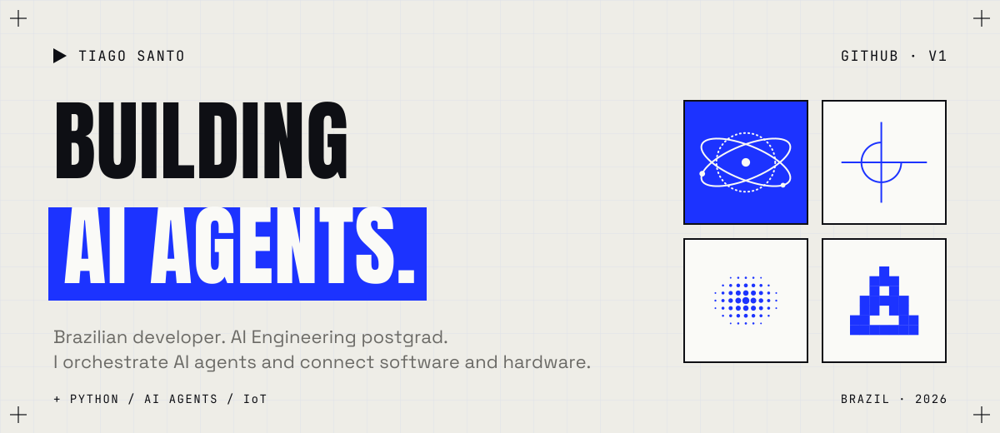

<picture>
  <source media="(prefers-color-scheme: dark)" srcset="assets/readme/header-dark.svg">
  
</picture>

 

<picture>
  <source media="(prefers-color-scheme: dark)" srcset="assets/readme/secao-01-dark.svg">
  
</picture>

Sou um desenvolvedor brasileiro movido por código, aprendizado contínuo e problemas que ainda não foram resolvidos. Gosto de procurar a solução certa, testar caminhos e construir coisas que tenham impacto de verdade.

Este perfil também é um experimento: estou construindo minha própria identidade visual com inteligência artificial e aplicando aos poucos no GitHub, nas propostas e nos vídeos.

 

<picture>
  <source media="(prefers-color-scheme: dark)" srcset="assets/readme/secao-02-dark.svg">
  
</picture>

`+ IA` &nbsp; **Agentes de IA.** Construção e orquestração de agentes. 
`+ SISTEMAS` &nbsp; **IoT e integrações.** Software conversando com hardware e outros sistemas. 
`+ CÓDIGO` &nbsp; **Python e scripts.** Automação para resolver o problema certo.

  
  
  

 

<picture>
  <source media="(prefers-color-scheme: dark)" srcset="assets/readme/secao-03-dark.svg">
  
</picture>

> **Uma nova solução para agentes de IA.** Não estou falando de skills básicas nem de mais um agente. Fica de olho e espera pelos resultados.

 

<picture>
  <source media="(prefers-color-scheme: dark)" srcset="assets/readme/secao-04-dark.svg">
  
</picture>

Tem uma ideia inovadora, um projeto para colaborar ou só quer trocar uma ideia? Vai ser um prazer conversar.

  
  

 

<picture>
  <source media="(prefers-color-scheme: dark)" srcset="assets/readme/secao-05-dark.svg">
  
</picture>

  
  

 

<code>▶ IDENTIDADE V1 · EM CONSTRUÇÃO · NOVEMBRO DE 2026</code>
