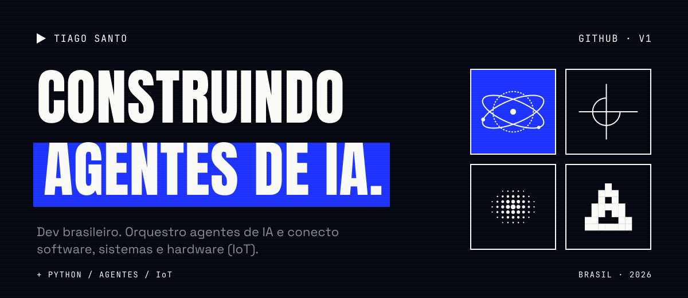

 

<picture>
  <source media="(prefers-color-scheme: dark)" srcset="assets/readme/secao-01-dark.svg">
  
</picture>

I'm a Brazilian developer driven by code, continuous learning and problems that haven't been solved yet. I like hunting for the right solution, testing different paths and building things that have real impact.

This profile is also an experiment: I'm building my own visual identity with AI and gradually bringing it to my GitHub, my proposals and my videos.

 

<picture>
  <source media="(prefers-color-scheme: dark)" srcset="assets/readme/secao-02-dark.svg">
  
</picture>

`+ AI` &nbsp; **AI agents.** Building and orchestrating AI agents. 
`+ STUDY` &nbsp; **AI Engineering.** Postgraduate studies in AI Engineering. 
`+ SYSTEMS` &nbsp; **IoT and integrations.** Software talking to hardware and other systems. 
`+ CODE` &nbsp; **Python and scripting.** Automation that solves the right problem.

  
  
  
  

 

<picture>
  <source media="(prefers-color-scheme: dark)" srcset="assets/readme/secao-03-dark.svg">
  
</picture>

> **A new solution for AI agents.** I'm not talking about basic skills or just another agent. Keep an eye out for the results.

 

<picture>
  <source media="(prefers-color-scheme: dark)" srcset="assets/readme/secao-04-dark.svg">
  
</picture>

Got an innovative idea, a project to collaborate on, or just want to connect? It will be a pleasure to chat.

  

 

<picture>
  <source media="(prefers-color-scheme: dark)" srcset="assets/readme/secao-05-dark.svg">
  
</picture>

  
  

 

<code>▶ IDENTITY V1 · WORK IN PROGRESS · NOVEMBER 2026</code>
